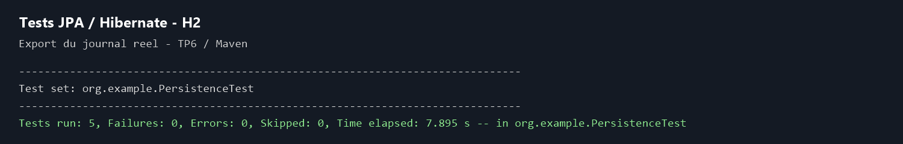
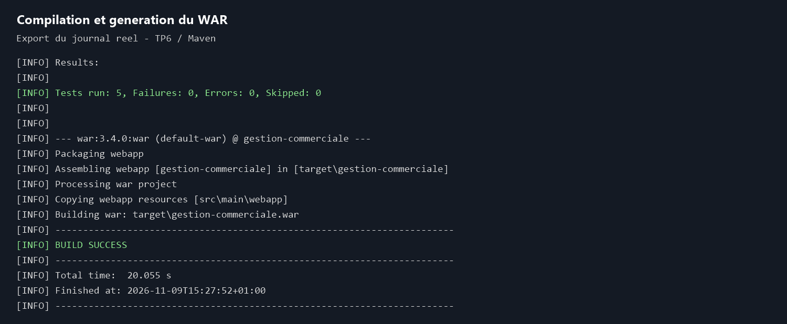

# TP6 — Gestion commerciale avec JPA et Hibernate

Projet Maven WAR : catégories, produits, utilisateurs et commandes. Le DAO utilise JPA avec transactions locales `RESOURCE_LOCAL` (EntityTransaction). Hibernate 5.6 fournit la persistance et une unique SessionFactory, également EntityManagerFactory ; le bootstrap passe par `hibernate.cfg.xml`. Il n'y a donc pas de deuxième factory ni de `defaultPU` manquante à configurer.

## Personnalisation

| Entité | Champs ajoutés |
| --- | --- |
| Categorie | description |
| Produit | reference unique, stock, actif |
| User | email unique, telephone |
| Client | adresseLivraison |
| Fournisseur | raisonSociale |
| Commande | reference unique, statut, note, client |
| CommandeProduit | prixUnitaire conservé à la commande |

Les montants sont exprimés en MAD. Le stock est un attribut de catalogue ; cette version ne le décrémente pas automatiquement lors des commandes.

Relations : Categorie → Produit (bidirectionnelle, cascade et orphanRemoval), User → Client/Fournisseur (JOINED), Commande → CommandeProduit → Produit (clé composée et MapsId). Un produit doit être enregistré avant d'être ajouté à une commande. Une catégorie ou un produit déjà référencé par une commande ne doit pas être supprimé : les clés étrangères protègent l'historique. Utiliser `actif=false` pour retirer un produit du catalogue.

Le rapport utilise CriteriaBuilder.prod et sum sur `prixUnitaire × quantite`. Il compte les commandes VALIDEE et LIVREE, entre le premier jour inclus et le premier jour du mois suivant exclu. Toutes les catégories sont présentes, y compris celles sans vente (0). Le prix historique évite de modifier rétroactivement les ventes quand le catalogue change.

## Organisation

- `src/main/java/org/example/entities` : mappings JPA.
- `dao` et `service` : CRUD, validations, Named Queries, Criteria et pagination.
- `web` : servlet du rapport et listener de fermeture de la factory.
- `src/main/resources/hibernate.cfg.xml` : configuration Hibernate.
- `src/main/webapp` : accueil et descripteur Servlet 4.
- `src/test/java/org/example/PersistenceTest.java` : tests JUnit sur H2.
- `sql` : création de la base et données de démonstration.
- [Guide de test avant GitHub](docs/TESTER.md).

Les associations restent LAZY. ProduitService charge explicitement la catégorie avec JOIN FETCH pour permettre sa consultation après fermeture de l'EntityManager. Pour modifier une collection LAZY, travailler dans une transaction avec une entité managed. Les méthodes génériques ne chargent pas automatiquement toutes les associations.

## Prérequis

JDK 11, Maven 3.8+, MySQL 8 et Apache Tomcat 9 (API javax.servlet). Utiliser le même JDK pour Maven et Tomcat. Le projet cible Java 11 ; le squelette initial ciblait Java 25. Le WAR s'appelle `gestion-commerciale.war`.

Configuration du processus qui lance Tomcat :

```powershell
$env:DB_URL = "jdbc:mysql://localhost:3306/gestion_commerciale?useSSL=false&serverTimezone=UTC&characterEncoding=UTF-8"
$env:DB_USER = "root"
$env:DB_PASSWORD = "votre_mot_de_passe_local"
```

Si Tomcat démarre depuis IntelliJ, saisir ces variables dans sa configuration de lancement. Un service Windows ne récupère pas les variables d'un autre terminal. Aucun mot de passe n'est à écrire dans le dépôt.

## Captures d'écran

Exports en images des journaux réels de l'exécution Maven du 9 novembre 2026 : 5 tests réussis sur H2 et génération du WAR avec `BUILD SUCCESS`. Le déploiement web avec MySQL et Tomcat reste à effectuer.





